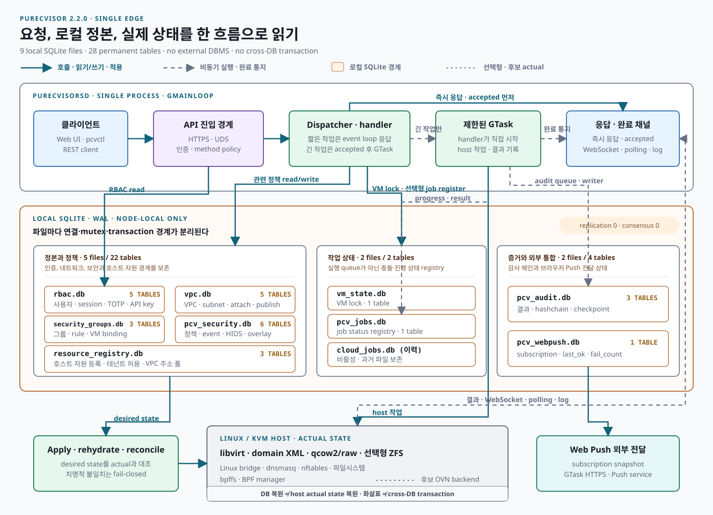

# PureCVisor Single Edge 데이터베이스 아키텍처 설명서

> **2026-10-08 역사 기준:** [10/8 변경·검증 인계](operations/2026-10-08-public-source-refresh-handoff.md)에서 AWS/S3 제거와 Job 접수·결과 저장 계약 보강을 적용했다.

> **2026-10-02 역사 기준:** 공개 제품 로직을 개발 main에 맞췄다. NVRAM·첫 알림 쿨다운 시정은 유지하며 LXC는 ZFS 전용이다. 공개 전용 Btrfs와 개발 main 미병합 후속 브랜치는 포함하지 않는다. [정합화 인계](operations/2026-10-02-public-main-sync-handoff.md)에서 이번 검증을 구분한다.


> **기준 시점:** 2026-11-11 공개 소스 2.2.0 (SQLite 9개 파일·28개 영구 테이블)
>
> **대상:** `purecvisor-single`의 SQLite 기반 영속 상태
>
> **문서 지위:** DB 파일별 책임, 데이터 소유권, 일관성·장애·백업 경계를 설명하는 개발·운영 정본

이 문서는 소스코드에 분산된 SQLite 저장소를 하나의 아키텍처로 설명한다. 실제 DDL과
마이그레이션의 단일 진실은 각 모듈의 `CREATE TABLE`, `ALTER TABLE`, `PRAGMA` 코드다. 이
문서는 그 구현을 운영자, 아키텍트, 개발자가 같은 기준으로 해석하기 위한 해설서다.

이 문서의 범위는 SQLite에 한정된다. libvirt domain XML, ZFS dataset·snapshot, 네트워크
JSON·메타데이터, nftables·OVS·OVN, bpffs, systemd 상태처럼 DB 밖에 있는 실제 상태도
PureCvisor의 전체 상태를 구성한다. 따라서 “DB 복원”은 곧 “서비스 전체 상태 복원”을
뜻하지 않는다.

---

## 1. 아키텍처 개요

`purecvisor-single`은 외부 DBMS를 요구하지 않고 로컬 SQLite 파일 9개로 상태를 나눠
저장한다. 이 9개 파일에는 영구 테이블 28개가 있으며, 모두 한 Single Edge 노드 안에서만
사용한다. 노드 간 복제·합의·분산 트랜잭션은 제공하지 않는다. 각 모듈이 자기 DB의 연결과
스키마를 소유하고 대부분 WAL 모드로 연다.

<div class="pcv-database-summary pcv-technical-wide" role="list" aria-label="데이터베이스 아키텍처 핵심 수치">
  <div class="pcv-database-summary-item" role="listitem"><strong>9</strong><span>로컬 SQLite 파일</span></div>
  <div class="pcv-database-summary-item" role="listitem"><strong>28</strong><span>영구 테이블</span></div>
  <div class="pcv-database-summary-item" role="listitem"><strong>0</strong><span>외부 DBMS</span></div>
  <div class="pcv-database-summary-item" role="listitem"><strong>0</strong><span>DB 간 원자 트랜잭션</span></div>
</div>

### 1.1 요청에서 실제 상태까지

<figure class="pcv-database-architecture pcv-control-map pcv-architecture-source" aria-labelledby="pcv-database-architecture-title" aria-describedby="pcv-database-architecture-note">
  <div class="pcv-map-bar">
    <strong id="pcv-database-architecture-title">Single Edge · 로컬 데이터 흐름</strong>
    <div class="pcv-map-meta">
      <span class="pcv-status"><i aria-hidden="true"></i>9 DB · 28 TABLES</span>
      <a class="pcv-architecture-source-open" href="../site/public/assets/diagrams/purecvisor-single-database-architecture.svg" target="_blank" rel="noopener">SVG 원본 열기 <span aria-hidden="true">↗</span></a>
    </div>
  </div>
  <a class="pcv-architecture-source-canvas pcv-database-architecture-canvas" href="../site/public/assets/diagrams/purecvisor-single-database-architecture.svg" target="_blank" rel="noopener" aria-label="클라이언트 요청이 purecvisorsd 제어면으로 들어와 요청 종류에 따라 9개 로컬 SQLite 파일 중 관련 저장소를 읽거나 갱신하고 Linux KVM 실제 상태 및 응답 완료 채널과 연결되는 데이터베이스 아키텍처 SVG를 새 탭에서 확대해서 보기">
    
  </a>
  <figcaption id="pcv-database-architecture-note" class="pcv-architecture-source-note">실선은 호출·읽기·쓰기·적용, 점선은 비동기 실행·진행·완료 통지와 증거 기록을 뜻한다.<br>화살표는 외래 키나 여러 DB를 묶는 하나의 transaction을 뜻하지 않는다.<br>좁은 화면에서는 그림 영역을 좌우로 스크롤하고, 전체 크기는 ‘SVG 원본 열기’에서 확인한다.</figcaption>
</figure>

그림은 저장소를 주 책임 기준의 세 묶음으로 나눠 읽는다. Security DB처럼 정책 정본과
보안 증거를 함께 맡는 저장소는 두 역할을 가질 수 있다.

- **정본과 정책**: RBAC, Local VPC, Security Group, Security DB와 자원 등록 DB가 사용자·네트워크·보안·호스트 자원 경계의 의도를 보존한다.
- **작업 상태**: VM lock과 Job 상태 registry가 충돌 방지·진행률·재시작 판정을 보존한다. DB가 worker를 실행하거나 작업을 꺼내 주지는 않는다.
- **증거와 외부 통합**: Audit은 변조 탐지형 감사 증거를, Security는 보안 이벤트를, Web Push는 브라우저 구독과 발송 결과를 보존한다.

### 1.2 저장소 레지스트리

| DB | 아키텍처 역할 | 저장 내용 | 기본 경로 | 경로 오버라이드 |
|---|---|---|---|---|
| VM 상태 | 작업 안전장치 | VM별 진행 중 작업 락 | `/var/lib/purecvisor/vm_state.db` | `PCV_VM_STATE_DB_PATH`, `[daemon].db_path`, `PURECVISOR_DB_PATH` |
| Audit | 변조 탐지형 감사 증거 | RPC/REST 호출 결과와 해시체인 | `/var/lib/purecvisor/pcv_audit.db` | `[audit].db_path` |
| Job 상태 | 운영 상태 registry | registry를 사용하는 비동기 작업의 진행률·결과 | `/var/lib/purecvisor/pcv_jobs.db` | `PCV_JOBS_DB_PATH`, `[jobs].db_path` |
| RBAC | 인증·인가 정본 | 사용자, 세션, TOTP, API key, 쿼터 | `/var/lib/purecvisor/rbac.db` | 현재 `main.c` 고정 인자 |
| Security | 보안 정본·증거 | 이벤트, 설정, 승인 액션, HIDS 기준선, overlay 키·tenant | `/var/lib/purecvisor/pcv_security.db` | `[security].db_path` |
| Security Group | 네트워크 정책 정본 | 보안 그룹, 규칙, VM 바인딩 | `/var/lib/purecvisor/security_groups.db` | 현재 코드 상수 |
| Local VPC | desired state 정본 | tenant VPC, subnet, attachment, Service Publish | `/var/lib/purecvisor/vpc.db` | `pcv_vpc_init()` 인자(테스트 주입) |
| Web Push | 외부 통합 상태 | 사용자별 브라우저 Push 구독 | `/var/lib/purecvisor/pcv_webpush.db` | 현재 `main.c` 고정 인자 |
| 자원 등록 | 인가 정본(호스트 자원 경계) | 비ADMIN이 참조할 수 있는 호스트 자원 등록·테넌트 허용, 테넌트 VPC 주소 풀(§11) | `/var/lib/purecvisor/resource_registry.db` | 코드 상수 `PCV_RES_DEFAULT_DB_PATH`(시험은 `pcv_res_registry_open()` 인자) |

비개발자 관점에서 보면 이 구조는 하나의 거대한 DB가 아니라 “작은 장부 여러 권”에 가깝다. VM 작업 충돌 방지, 감사 기록, 사용자 인증, 보안 이벤트처럼 성격이 다른 기록을 분리해 장애 영향 범위와 백업 단위를 줄인다.

화살표는 호출·수렴 방향이지 외래 키나 하나의 트랜잭션을 뜻하지 않는다. 예를 들어
상태 registry를 사용하는 장시간 작업은 실제 결과를 `pcv_audit.db`에 남기고 결과 journal과
`pcv_jobs.db`를 따로 갱신하지만 이 쓰기들은 서로 다른 연결과 트랜잭션이다. 한쪽 쓰기만 성공할 수 있으므로
Job ID, audit, 로그, WebSocket 결과를 함께 대조해야 한다.

### 1.3 데이터 정본과 재구성 경계

| 상태 종류 | SQLite의 역할 | DB 밖 상태와의 관계 |
|---|---|---|
| 인증·정책·desired state | RBAC, Security, Security Group, Local VPC, 자원 등록이 의도를 보존 | 실제 커널·가상화 상태는 별도 적용 또는 reconcile 필요 |
| 작업 중 상태 | VM lock과 Job 상태 registry가 충돌 방지와 진행률을 보존 | 실제 작업 결과는 libvirt·qcow2/raw·선택형 ZFS·파일시스템과 함께 판정 |
| 증거·외부 통합 | Audit, Security event, Web Push가 과거 사실이나 외부 전달 상태를 보존 | 현재 host 상태를 직접 제어하지 않으며 삭제·손상 시 증거 또는 구독이 유실됨 |

Local VPC DB는 desired state의 정본이지만 bridge, dnsmasq, nftables, libvirt XML과 후보
OVN backend는 actual state다. 데몬은 시작 시 둘을 수렴시킨다. VM DB는 VM 정의의 정본이 아니라 작업
충돌을 막는 임시 락 장부다. BPF 프로그램의 attach 상태도 Security DB가 아니라 bpffs와
BPF manager에서 확인한다.

---

## 2. 공통 운영 원칙

### 모듈별 연결과 일관성 경계

[ADR-0001](adr/0001-no-fork-single-daemon.md)의 단일 프로세스 구조 안에서 DB마다
별도 SQLite connection, `GMutex`, 전용 queue 또는 `BEGIN IMMEDIATE`를 사용한다. DB 안의
원자성은 해당 모듈의 트랜잭션이 보장하지만 DB 사이의 원자성은 보장하지 않는다.

- 다른 DB를 SQL `JOIN`하거나 cross-database foreign key로 연결하지 않는다.
- `job_id`, 사용자명, VM UUID·이름, VPC ID 같은 애플리케이션 식별자로 결과를 연결한다.
- 한 DB 갱신 뒤 다른 DB 갱신이 실패할 수 있으므로 worker의 최종 audit, 오류 로그,
  restart reconcile을 복구 경계로 사용한다.
- fire-and-forget 작업은 [ADR-0018](adr/0018-fire-and-forget-audit-policy.md)에 따라 worker
  callback에서 실제 결과를 audit하고 Job ID + WebSocket + polling 결과 채널을 유지한다.

### 초기화 실패와 서비스 영향

| DB | 현재 실패 처리 | 운영 해석 |
|---|---|---|
| VM 상태 | DB를 열지 못해도 lock API가 fail-open으로 동작 | 데몬은 계속될 수 있지만 VM별 직렬화 보장은 사라진다. 안전한 정상 상태로 간주하지 않는다. |
| Audit | DB open 실패는 file-only 축소 운영. sidecar lock 충돌, schema/epoch 준비 실패, 활성 epoch 손상은 listener 전에 기동 중단 | 현재 감사 체인의 단일 writer·무결성은 fail-closed다. |
| Job 상태 | 초기화 실패 시 registry persistence 비활성 | registry를 사용하는 신규 요청은 접수를 거절하며 worker를 시작하지 않는다. |
| RBAC | DB·schema 초기화 실패 시 새 로그인·API key 검증은 실패하고 role 조회 fallback은 `VIEWER`로 제한 | 권한 상승으로 우회하지는 않지만 기존 JWT의 일부 읽기 경로까지 DB 정상으로 오인하면 안 된다. bootstrap 비밀번호 미설정 시 알려진 기본 계정을 만들지 않는다. |
| Security | open/schema 실패 시 degraded, 조회는 빈 container가 될 수 있음 | “이벤트 0건”과 “DB 미가용”을 구분해 로그·health를 함께 본다. |
| Security Group | DB 미가용 시 일부 경로는 인메모리·커널 동작을 계속하고 영속화를 생략 | 재시작 뒤 정책 복원이 보장되지 않는다. |
| Local VPC | 미래 schema는 DDL 전에 거부. 치명적 init/migration/reconcile 실패는 listener 전에 중단하고 격리 가능한 actual 오류는 quarantine | desired state를 임의로 덮어쓰지 않는 fail-closed 경계다. |
| Web Push | 초기화 실패 시 알림 발송만 no-op으로 축소 | webhook·이력·핵심 서비스는 유지되지만 Push 채널은 사용할 수 없다. |
| 자원 등록 | 데몬 시작 때 열지 않고 첫 사용 때 연다. 열기·이관 실패나 지원보다 높은 `user_version`이면 관리 RPC(`resource.*`·`vpc.pool.*`)는 −32603이고, 비ADMIN의 자원 참조·VPC subnet 풀 판정은 거절(−32006, fail-closed) | ADMIN 요청은 이 DB를 보지 않아 영향이 없다. 비ADMIN의 호스트 자원 참조와 VPC subnet 생성만 막힌다. |

### 연결 수명과 종료 순서

`main.c`는 RBAC, Web Push, Local VPC, VM 상태, Job 상태 registry와 Audit을 명시적으로 종료한다.
Web Push는 새 발화를 막은 뒤 진행 중 전송을 취소하고 최대 30초만 기다린다. Local VPC는
요청 drain 뒤 libvirt·spawn 종료 전에 닫는다. Audit은 `pcv_audit_shutdown()`에서 writer
종료를 요청하고 남은 queue를 처리한 worker의 종료를 기다린 뒤 DB를 닫는다.

현재 구현에는 다음 process-lifetime 제약이 있다. 이는 목표 계약이 아니라 종료 배선이나
신규 lifecycle 작업에서 확인해야 할 현행 상태다.

- `pcv_security_store_close()` API는 존재하지만 `main.c` cleanup에 연결되어 있지 않다.
- Security Group 전역 connection에는 명시적 public close 경로가 없다.
- 자원 등록 DB는 `main.c`가 열거나 닫지 않는다. 첫 사용 때 지연해서 열고 `pcv_res_registry_close()`는
  시험·종료 정리용 seam이며 현재 종료 배선에 연결돼 있지 않다.
- 정상 프로세스 종료 시 OS가 파일 descriptor를 회수하지만, 이 사실만으로 queue drain이나
  명시적 WAL checkpoint가 수행됐다고 간주하지 않는다.

### SQLite WAL 파일까지 함께 취급

대부분의 DB는 `PRAGMA journal_mode=WAL`로 열린다. WAL 모드에서는 기본 DB 파일 외에 다음 파일이 생길 수 있다.

```text
example.db
example.db-wal
example.db-shm
```

백업, 복사, 장애 분석 시에는 세 파일을 한 세트로 다뤄야 한다. 실행 중인 데몬의 DB 파일만
단독 복사하면 최근 쓰기가 빠질 수 있다. 권장 순서는 다음과 같다.

1. 가장 단순하고 확실한 방식은 요청을 drain하고 데몬을 정상 정지한 뒤 DB 파일을 복사하는 것이다.
2. 무중단 백업이 필요하면 SQLite online backup API 또는 일관된 snapshot 절차를 사용한다.
3. 실행 중 파일 복사를 피할 수 없다면 같은 시점의 `.db`, `.db-wal`, `.db-shm`을 함께 보존한다.
4. 복원 뒤 `PRAGMA integrity_check`, 모듈별 schema 검사, audit hashchain, VPC reconcile을 수행한다.

`config.backup` RPC는 `/etc/purecvisor/daemon.conf`만
`/var/lib/purecvisor/daemon.conf.<timestamp>`로 복사한다. 9개 SQLite DB를 백업하지 않는다.

복구 우선순위는 데이터 성격에 따라 다르다.

| 우선순위 | 저장소 | 복구 시 핵심 조건 |
|---|---|---|
| 높음 | RBAC, Local VPC, Security Group, Security, 자원 등록 | 인증·desired state·암호화 키의 무결성과 actual state 재수렴. 자원 등록 DB는 판(`user_version`)이 바이너리와 맞아야 한다(§11) |
| 증거 보존 | Audit, Security event | audit 체인 검증과 보안 이벤트 원본 시각 보존 |
| 운영 재구성 가능 | VM lock과 Job 상태 registry | 고아 락 제거, 비종료 job의 실패·재시도 판정 |
| 통합 상태 | Web Push | DB와 `webpush_vapid.pem`을 같은 복구 단위로 관리. PEM이 바뀌면 기존 구독은 재등록 필요 |

### DB 파일 직접 수정 금지

운영 중 DB를 `sqlite3` CLI로 직접 수정하면 다음 문제가 생길 수 있다.

- 데몬의 메모리 상태와 DB 상태가 어긋난다.
- WAL에 남은 쓰기와 수동 변경이 충돌한다.
- audit, job completion, WebSocket 알림 같은 후속 처리 없이 상태만 바뀐다.

운영 변경은 RPC/API 또는 전용 복구 절차로 처리한다. 분석용 조회는 가능하지만, 변경 전에는 반드시 데몬 정지, 백업, 변경 계획, 복구 계획을 먼저 준비한다.

### 스키마 버전 방식

별도 `schema_version` 테이블 중심의 공통 마이그레이션 프레임워크는 없다. 대부분의 DB는
모듈 초기화 시 `CREATE TABLE IF NOT EXISTS`, `CREATE INDEX IF NOT EXISTS`, 일부
`ALTER TABLE ... ADD COLUMN`로 구조를 보장한다. RBAC는 `PRAGMA user_version`을 API key
저장 role 마이그레이션의 1회성 표식으로만 사용한다(1 = 실효 role 동결, 2 = 저장 role 하향, §6).
Local VPC는 `PRAGMA user_version=2`, 자원 등록은 `PRAGMA user_version=2`(§11)를 사용하며 지원
버전보다 높은 DB를 변경하지 않고 거부한다. Job 상태 DB도 `PRAGMA user_version=2`를 쓴다(§5).

2.1.0 대비 2.2.0의 스키마 변화는 없다. USB 영구 할당은 libvirt 도메인 정의가 정본이고 `host.device.list`는 sysfs와
libvirt 정의를 읽기만 한다.

2.0.4 대비 2.1.0의 스키마 변화는 다음과 같다. 모두 데몬 시작 또는 첫 사용 때 자동으로 적용되며,
이전 판 바이너리로 되돌릴 때의 주의는 각 절에 적는다.

- Job 상태 DB: `jobs` 열 4개(`generation`, `method`, `recovery_reason`, `outcome_known`), 인덱스
  `idx_jobs_method_target`, `PRAGMA user_version=2`와 결과 journal 디렉터리(§5)
- VM 상태 DB: `vm_locks.owner` 열(§3)
- RBAC DB: `users.identity_nonce`·`sessions.identity_nonce` 열과 `PRAGMA user_version=2`(§6)
- Security DB: `security_events` 열 6개와 인덱스 `idx_security_events_status_last_seen`(§7)
- 자원 등록 DB: 새 파일과 영구 테이블 3개(§11)

`db.migration.status` RPC가 반환하는 `schema_version=1`, `status=up_to_date`, RBAC·Audit
경로는 현재 정적 호환 응답이다. 모든 DB의 `PRAGMA user_version`, DDL, 무결성을 조회하는
전역 migration health가 아니므로 운영 판정의 단일 근거로 사용하지 않는다.

스키마를 바꿀 때는 다음을 함께 처리한다.

- 생성 SQL 또는 보정 SQL 수정
- 이 문서의 필드 설명 갱신
- 기존 DB를 가진 노드에서의 업그레이드 동작 확인
- 관련 단위/통합 테스트 실행
- 운영자가 백업할 DB 파일과 WAL 파일 명시

### 접근 권한과 헬스 관측 경계

systemd unit의 `UMask=0077`이 기본 파일 생성을 제한하며 자원 등록 DB와 Web Push VAPID PEM은
코드에서도 `0600`을 강제한다. Security Group DB는 열기 전에 본체와 기존 `-wal`·`-shm`을 `0600`으로
보정하고, 보정 실패는 경고만 남긴다(§8). RBAC hash·salt, TOTP secret, Push endpoint·key,
WireGuard 암호문, 감사 기록은 모두 민감 데이터로 취급한다. DB 파일을 공개 artifact나
일반 진단 번들에 포함하지 않는다.

서비스 top-level health는 disk, Audit DB·chain, VM state 등 일부 핵심 probe만 포함하며
9개 저장소 모두의 쓰기 가능성을 증명하지 않는다. 따라서 `health=ok`와 “모든 DB 정상”은
같은 명제가 아니다.

---

## 3. VM 상태 DB

### 목적

VM 상태 DB는 VM별로 동시에 실행되면 안 되는 작업을 막는 락 장부다. 예를 들어 같은 VM에 대해 `start`와 `delete`가 동시에 들어오면 데이터 손상이나 libvirt 상태 불일치가 생길 수 있으므로, 먼저 락을 얻은 작업만 진행한다.

### 위치와 초기화

| 항목 | 값 |
|---|---|
| 기본 경로 | `/var/lib/purecvisor/vm_state.db` |
| 코드 | `src/modules/core/vm_state.c`, `src/modules/core/vm_state.h` |
| 초기화 함수 | `init_pending_state_machine()` |
| 동시성 | `GMutex`, SQLite 트랜잭션, WAL |
| 잠금 API | 핸들 `PcvVmLock` — `pcv_vm_lock_acquire` / `pcv_vm_lock_release` / `pcv_vm_lock_renew` |
| 마이그레이션 | 시작 때 `owner` 열이 없으면 `ALTER TABLE vm_locks ADD COLUMN owner TEXT`(`_ensure_owner_column`) |
| 복구 | 데몬 재시작 시 죽은 PID의 고아 락을 삭제 |

### 스키마

#### 테이블: `vm_locks`

| 컬럼 | 타입 | 제약 | 의미 |
|---|---|---|---|
| `vm_id` | `TEXT` | `PRIMARY KEY` | 잠금 키. UUID 표기 식별자는 현재 도메인 이름으로 정규화하고, 그 밖에는 받은 식별자(아래) |
| `op_type` | `INTEGER` | `NOT NULL` | 진행 중인 작업 종류 |
| `pid` | `INTEGER` | `NOT NULL` | 락을 잡은 데몬 프로세스 PID |
| `locked_at` | `INTEGER` | `NOT NULL` | Unix timestamp 초 단위 |
| `owner` | `TEXT` | 없음(NULL 허용) | 잠금 소유 토큰(무작위 UUID) |

`op_type` 값은 `VmPendingOp` 열거형을 따른다.

| 값 | 이름 | 의미 |
|---:|---|---|
| 0 | `VM_OP_NONE` | 작업 없음, DB에 저장하지 않는 상태 |
| 1 | `VM_OP_STARTING` | VM 시작 중 |
| 2 | `VM_OP_STOPPING` | VM 종료 중 |
| 3 | `VM_OP_DELETING` | VM 삭제 중 |
| 4 | `VM_OP_CREATING` | VM 생성 중 |
| 5 | `VM_OP_TUNING` | vCPU/메모리 핫플러그 중 |
| 6 | `VM_OP_SNAPSHOT` | 스냅샷 생성 또는 롤백 중 |
| 7 | `VM_OP_MIGRATING` | 예약 상태. Single Edge 공개판은 라이브 마이그레이션 절차를 제공하지 않음 |

운영 의미는 단순하다. 이 DB에 행이 있다는 것은 “해당 VM은 지금 누군가 작업 중이므로 다른 위험 작업을 받으면 안 된다”는 뜻이다.

`vm.batch` stop도 VM마다 `VM_OP_STOPPING`을 얻는다. 종료 이벤트 처리기는 회수 직전에 이 표의
유효한 `VM_OP_STARTING` 행(잠금과 같은 op별 TTL·PID 생존 규칙)을 읽기만 하고, 시작 중이면 늦은
종료 이벤트의 코어 회수를 건너뛴다(`pcv_vm_state_start_in_progress`).

잠금은 핸들 API이고 행마다 소유 토큰을 가진다.

- **키 정규화**: 호출자가 넘긴 식별자가 UUID 표기(앞뒤 공백, 쌍 사이 `-`·공백, 32 hex —
  `pcv_validate_is_uuid_like`)이면 데몬이 등록한 libvirt 해석 함수로 현재 도메인 이름을 얻어
  `vm_id`에 쓴다. 그 밖의 식별자와 도메인이 없는 UUID는 받은 문자열이 키다. 연결을 얻지 못하면
  행을 쓰지 않고 획득을 거절한다(fail-closed). 그래서 같은 VM의 이름·UUID 작업이 같은 행을 두고
  경쟁한다. 이름 변경은 키를 바꾸므로 `vm.rename`이 옛 이름·새 이름 두 행을 잡는다.
- **소유 토큰**: 획득 판정(`BEGIN IMMEDIATE`, PID 생존, op별 TTL, 만료·죽은 PID 행 덮어쓰기)은
  그대로이고 새 행에 무작위 토큰을 `owner`에 넣는다. 해제는 `DELETE … WHERE vm_id = ? AND owner = ?`,
  갱신은 `UPDATE … WHERE vm_id = ? AND owner = ?`다. 지운 행이 0개면(TTL이 지나 다른 작업이
  가져감) 경고 로그만 남긴다. DB가 없으면 잠금 없이 진행한다.
- **마이그레이션·원복**: `init_pending_state_machine`이 `PRAGMA table_info(vm_locks)`로 열을 확인하고
  없으면 `ALTER TABLE … ADD COLUMN owner TEXT`를 한다. 열 추가뿐이라 되돌릴 수 있다 — 2.0.4 이하
  판은 열 이름을 명시해 읽고 써서 `owner`를 무시한다. 업그레이드 경계에 남는 `owner` NULL 행은
  시작 정리·만료·죽은 PID 규칙으로 회수된다.

이 표는 VM만 쓰지 않는다(스키마는 같다). 컨테이너 작업은 컨테이너 이름을 `vm_id` 키로 같은 API를
쓴다. 생성·삭제·시작·정지 외에 `container.env.set`·`container.env.delete`·`container.set_limits`·볼륨
attach·detach는 `VM_OP_TUNING`을 비차단으로 잡고(못 잡으면 −32004), 스냅샷 롤백은 `VM_OP_SNAPSHOT`을 잡는다. 복제는
원본 `VM_OP_SNAPSHOT`·대상 `VM_OP_CREATING`을 잡고 작업 중 주기적으로 갱신한다. 오프로드 경로에서
도는 비 ZFS `vm.snapshot.create`·`delete`도 `VM_OP_SNAPSHOT`을 잡고 60초마다 갱신한다
(`snapshot_fallback_lock.c`). 그래서 이 표의 행은 VM 이름일 수도, 컨테이너 이름일 수도 있다.

---

## 4. Audit DB

### 목적

Audit DB는 누가, 언제, 어떤 API/RPC를 호출했고 실제 결과가 무엇이었는지 남기는 감사
장부다. 보안 분석, 장애 원인 분석, 운영 책임 추적에 사용한다. 활성 기록은 epoch별
해시체인으로 연결하며 [ADR-0034](adr/0034-audit-hashchain-atomic-append-and-epochs.md)가
원자 append, legacy 보존, 기동 검증 경계를 정의한다.

### 위치와 초기화

| 항목 | 값 |
|---|---|
| 기본 경로 | `/var/lib/purecvisor/pcv_audit.db` |
| 코드 | `src/modules/audit/pcv_audit.c`, `src/modules/audit/pcv_audit_chain.c`, 각 헤더 |
| 초기화 함수 | `pcv_audit_init()` |
| 호출 위치 | `src/main.c` |
| 단일 writer guard | `<db_path>.lock`의 non-blocking `flock`; 충돌 시 기동 실패 |
| 동시성 | 비동기 queue + 전용 worker, WAL, append별 `BEGIN IMMEDIATE` |
| 보존 | 30일 초과 기록 삭제, 약 1GB DB 상한 |
| 장애 동작 | SQLite open 실패는 file-only mode; schema·epoch·활성 체인 오류는 listener 전 실패 |

### 스키마

#### 테이블: `audit_log`

| 컬럼 | 타입 | 제약 | 의미 |
|---|---|---|---|
| `id` | `INTEGER` | `PRIMARY KEY AUTOINCREMENT` | 감사 레코드 내부 ID |
| `ts` | `TEXT` | `NOT NULL` | worker가 DB에 기록한 UTC 시각, 초 정밀도 |
| `event_ts` | `TEXT` | nullable | `pcv_audit_log()` 호출 시각, UTC 마이크로초 정밀도. queue 지연 분석용 |
| `node` | `TEXT` | `NOT NULL` | 기록한 노드/호스트명 |
| `username` | `TEXT` | nullable | 요청 행위자. REST는 인증 주체, gRPC는 `grpc`, UDS 직결은 `local-admin`, 데몬 기원(자가치유 등)은 `system`이며 워커·콜백·파생 제출의 감사도 요청 행위자를 남긴다. 인증 주체가 없는 실패는 `-` |
| `method` | `TEXT` | `NOT NULL` | RPC/API 메서드 |
| `target` | `TEXT` | nullable | 대상 VM, 리소스, 작업 ID 등 |
| `result` | `TEXT` | `NOT NULL` | 성공, 실패, accepted 등 결과 |
| `error_code` | `INTEGER` | nullable | 실패 시 표준 오류 코드 |
| `duration_ms` | `INTEGER` | nullable | 처리 시간 |
| `src_ip` | `TEXT` | nullable | REST 호출 출발 IP |
| `prev_hash` | `TEXT` | nullable | 같은 epoch 직전 레코드의 `rec_hash`; 첫 행은 epoch 기준 hash |
| `rec_hash` | `TEXT` | nullable | `SHA256(prev_hash\|ts\|username\|method\|target\|result\|error_code)` |
| `chain_epoch` | `INTEGER` | nullable | 활성 hashchain epoch. migration 전 legacy 행은 `NULL` 유지 |

`event_ts`는 호출 시각이고 `ts`는 기록 시각이다. hash preimage에는 `ts`가 들어가며
`event_ts`는 queue 지연 관측 필드다. 마이그레이션은 기존 legacy 행을 다시 쓰지 않고 그
마지막 ID·hash·검증 상태를 새 epoch의 predecessor 경계로 기록한다.

#### 테이블: `audit_chain_epoch`

| 컬럼 | 의미 |
|---|---|
| `epoch_id` | `INTEGER PRIMARY KEY AUTOINCREMENT`, epoch 식별자 |
| `started_at`, `closed_at` | epoch 시작·종료 시각. `closed_at IS NULL`인 활성 epoch는 정확히 하나여야 함 |
| `baseline_prev_hash` | epoch 첫 행이 연결할 기준 hash |
| `predecessor_last_id`, `predecessor_last_hash` | 직전 legacy/epoch 경계의 마지막 레코드 |
| `predecessor_status`, `predecessor_break_id` | 직전 구간 검증 상태와 최초 손상 위치 |
| `reason` | 새 epoch를 연 이유 |

#### 테이블: `audit_chain_checkpoint`

| 컬럼 | 의미 |
|---|---|
| `epoch_id`, `first_retained_id` | 복합 primary key; retention 뒤 남은 구간의 시작점 |
| `created_at` | checkpoint 생성 시각 |
| `expected_prev_hash` | 첫 보존 행이 원래 연결돼 있던 predecessor hash |
| `reason` | checkpoint 생성 이유 |

30일 retention은 먼저 활성 체인을 검증한 뒤 checkpoint 기록과 ID prefix 삭제를 같은
transaction에서 처리한다. 오래된 행을 삭제한 뒤에도 남은 첫 행의 연결 기준을 검증할 수
있는 이유가 이 checkpoint다.

#### 인덱스

| 인덱스 | 컬럼 | 용도 |
|---|---|---|
| `idx_audit_ts` | `ts` | 시간순 조회와 보존 기간 삭제 |
| `idx_audit_method` | `method` | 특정 메서드 호출 이력 조회 |
| `idx_audit_epoch_prev` | `chain_epoch`, `prev_hash` | 활성 epoch predecessor 분기 방지용 partial unique index |
| `idx_audit_epoch_id` | `chain_epoch`, `id` | epoch별 순차 검증 |

append는 `BEGIN IMMEDIATE` 안에서 현재 head 조회, hash 계산, INSERT, COMMIT을 수행한다.
process-local head cache에 의존하지 않으므로 다른 SQLite connection이 끼어들어도 같은
predecessor에서 두 갈래가 생기지 않는다. 파일 감사 로그는 DB append가 실패해도 남긴다.

fire-and-forget RPC는 accepted 응답만으로 끝나지 않는다. ADR-0018에 따라 worker callback에서
실제 성공/실패 결과를 다시 `pcv_audit_log()`로 남겨야 한다. 알려진 legacy 손상은
`historical_break`로 보존할 수 있지만 활성 epoch 손상·orphan·복수 활성 epoch는 현재
무결성 실패이며 데몬 listener를 열지 않는다.

---

## 5. Job 상태 DB

### 목적

Job 상태 DB는 registry를 사용하는 장시간 작업의 현재 상태를 저장한다. 구현 모듈 이름은
`pcv_job_queue`지만 DB에서 작업을 꺼내 worker에 전달하지 않는다. handler가 Job ID의 접수 행을 먼저 저장하고
저장 성공 시 accepted 응답을 보낸 뒤 `GTask`를 직접 시작하며, worker가 진행률과 최종 결과를 이 DB에 기록한다.

Local VPC처럼 이 registry를 사용하는 경로가 있는 반면, VM lifecycle·backup·Security의 일부
`GTask` 경로는 합성 Job ID와 WebSocket 완료 통지만 사용한다. 따라서 `pcv_jobs.db`에 행이
없다는 사실만으로 비동기 작업이 실행되지 않았다고 판정하지 않는다.

추적 Job은 INSERT가 실제 성공한 경우에만 접수합니다. PK 충돌은 제한된 횟수로 새 ID를
발급하며 기존 행을 덮어쓰지 않습니다. DB가 비활성인 경우에도 daemon은 살아 있지만 신규
추적 작업은 거절합니다. 실제 작업 결과와 결과 저장 성공 여부는 분리하며, 저장 실패는
`result_persisted: false`로 전달해 Job ID와 로그 확인 경로를 안내합니다.

### 위치와 초기화

| 항목 | 값 |
|---|---|
| 기본 경로 | `/var/lib/purecvisor/pcv_jobs.db` |
| 코드 | `src/utils/pcv_job_queue.c`, `src/utils/pcv_job_queue.h` |
| 초기화 함수 | `pcv_job_queue_init()` |
| 호출 위치 | `src/main.c` |
| 동시성 | `GMutex`, WAL |
| 장애 동작 | SQLite open·WAL·스키마 준비 실패나 지원보다 높은 `user_version`이면 registry 비활성, 신규 추적 Job 접수 거부 |
| 스키마 버전 | `PRAGMA user_version=2` |
| 결과 journal | `<db_path>.journal/` 디렉터리(파일 `0600`) |
| 보존 | 결과가 확정된(`outcome_known=1`) 완료·실패·취소 Job만 `[daemon].job_retention_days`(기본 30일, 0 이하는 끔)를 넘기면 하루 한 번 삭제한다. 대기·실행 중·미확정 Job과 결과 복구 대기·격리 Job은 남긴다 |

### 접수·결과 복구 계약

추적 접수 경로(`vm.create`·`vm.delete`, OVA export/import, 백업 복원·증분·복제, Local VPC 등)는
`pcv_job_admit()`으로 SQLite transaction과 결과 slot 확보가 성공한 뒤에만 ID·accepted를 반환한다
([ADR-0060](adr/0060-job-admission-and-result-persistence.md)). PK 충돌은 최대 32회 재발급한다.
`PcvJobRef`가 ID·세대 UUID·method·nullable target을 접수 때 복사하며 완료 때 DB에서 새 세대를
조회하지 않는다. ID 전용 create/update/result 선언은 `tests/fixtures/job_queue_legacy.h`의 시험
전용이며 생산 header에는 없다.

실제 worker audit는 실제 효과에 대해 한 번 기록한다. `pcv_ws_finish_job()`이 결과를 단일 GTask
writer로 복사하고 `<db_path>.journal/`의 0600 임시 파일 → 전체 write → 파일 fsync → rename →
directory fsync를 수행한 뒤 terminal DB를 갱신한다. journal에 params/인증 정보는 넣지 않으며
checksum·버전·ID·세대·method·target·상태·결과/오류를 검사한다. 다른 세대·대상·method나 상충
terminal을 덮어쓰지 않는다. 같은 replay는 멱등이다.

`result_persisted`는 조회 DB 저장 성공이고 `recovery_pending`은 내구성 결과의 DB 반영 또는 journal
삭제 재시도가 남았다는 뜻이다. WS가 유실돼도 결과 파일이 내구화됐다면 polling으로 수렴한다.
startup은 replay 후 내구성 결과가 없는 이전 pending/running을 `interrupted`,
`outcome_known=false`로 바꾼다. 실제 작업은 자동 재실행하지 않는다. 시작 정리는 하나의
transaction이며 실패하면 전부 rollback한다. 잠금/쓰기 오류는 동일 writer에서 아래 backoff로
재시도하며 성공 전까지 신규 tracked 접수를 차단한다. 한 번 성공한 시작 정리는 다시 실행하지 않아
현재 process의 새 Job을 보호한다. 취소는 요청 상태이며 worker 효과 확증과 별개다. 손상·부분·identity
충돌 파일은 원문을 quarantine하고 unresolved/불명확 row는 시간 만료만으로 삭제하지 않는다.

record 64KiB, 미완료/대기 결과 128개, 대기 결과 직렬화 크기 8MiB, 파일 256개·16MiB
(temp/quarantine/metadata 포함)가 상한이다. 재시도는 1초부터 최대 60초 backoff, 회차당 32회다.
상한 밖 결과를 잘라 성공으로 바꾸지 않는다. startup의 기존 결과가 대기 상한을 넘으면 파일과
`retry_capacity` 사유를 보존하고 새 회차에서 복구한다.

`PRAGMA user_version=2`는 table/index와 4개 컬럼 확장을 하나의 transaction으로 적용하고 이전 row의
세대 UUID·method·결과 확증 여부를 채운다. 중간 실패는 원래 schema로 rollback하며 미지원 미래 version은 접수를
거부한다. 새 schema를 모르는 이전 binary/UI로 자동 원복하지 않는다. 2.0.4 이하 공개판의 Job 코드는
`interrupted`(5)를 `unknown`으로 읽고, 이전 TTL 정리 API(`pcv_job_queue_cleanup_old`)를 호출하면 결과가
확증되지 않은 이력도 지운다(생산 코드에는 자동 호출이 없다). 새 DB에 쓰면 세대·method가 비고 결과
확증도 남기지 않는다. 되돌릴 때는 업그레이드 전에 데몬을 정지하고 떠 둔 WAL 포함 `pcv_jobs.db*`
사본을 기준으로 하고, 그 이후 Job 이력은 별도로 보관·대조한다. 미확증·미완료 작업이나 journal
잔여가 있으면 복원하지 않는다. 실제 효과·audit는 Job DB와 함께 되돌아가지 않는다.

### 스키마

#### 테이블: `jobs`

| 컬럼 | 타입 | 제약 | 의미 |
|---|---|---|---|
| `job_id` | `TEXT` | `PRIMARY KEY` | `job-...` 형태의 작업 ID |
| `type` | `TEXT` | `NOT NULL` | 작업 유형 |
| `target` | `TEXT` | nullable | 대상 VM 또는 리소스 |
| `status` | `INTEGER` | `DEFAULT 0` | 작업 상태 코드 |
| `progress` | `INTEGER` | `DEFAULT 0` | 0부터 100까지 진행률 |
| `detail` | `TEXT` | nullable | 현재 단계 설명 |
| `params` | `TEXT` | nullable | 요청 파라미터 JSON 문자열 |
| `result` | `TEXT` | nullable | 완료/실패 결과 JSON 문자열 |
| `created_at` | `INTEGER` | nullable | 생성 시각 Unix timestamp |
| `updated_at` | `INTEGER` | nullable | 마지막 갱신 시각 Unix timestamp |
| `generation` | `TEXT` | `NOT NULL`, 기본 빈 문자열 | tracked 접수 세대 UUID; 빈 값은 legacy 회귀 API |
| `method` | `TEXT` | `NOT NULL`, 기본 빈 문자열 | 접수한 RPC method |
| `recovery_reason` | `TEXT` | nullable | restart/cancel 사유; 조회에서 메모리 journal 사유를 보완 |
| `outcome_known` | `INTEGER` | `NOT NULL`, 기본 0 | 실제 결과 확증 여부 |

`status` 값은 `PcvJobStatus` 열거형을 따른다.

| 값 | 이름 | 의미 |
|---:|---|---|
| 0 | `PCV_JOB_PENDING` | 생성 직후 대기 |
| 1 | `PCV_JOB_RUNNING` | 실행 중 |
| 2 | `PCV_JOB_COMPLETED` | 정상 완료 |
| 3 | `PCV_JOB_FAILED` | 실패 |
| 4 | `PCV_JOB_CANCELLED` | 취소 요청, 실제 worker 효과와 별개 |
| 5 | `PCV_JOB_INTERRUPTED` | 재시작 뒤 실제 결과 불명확 |

#### 인덱스

| 인덱스 | 컬럼 | 용도 |
|---|---|---|
| `idx_jobs_status` | `status` | 실행 중/대기 중 작업 조회 |
| `idx_jobs_created` | `created_at DESC` | 최근 작업 목록 조회 |
| `idx_jobs_method_target` | `method`, `target`, `created_at` | 같은 메서드·대상의 최신 Job 조회(`pcv_job_find_latest` — `vm.delete.status`). 만들기에 실패해도 registry는 켜지고(경고만, 조회는 표 훑기) `user_version`은 2 그대로다 |

비개발자 관점에서는 “registry에 등록된 작업 현황판의 원천 데이터”다. UI나 API가 해당 작업의
진행률을 보여줄 때 이 DB를 기준으로 하되, 모든 `GTask`의 전역 실행 목록으로 해석하지 않는다.

---

## 6. RBAC DB

### 목적

RBAC DB는 로그인 사용자, refresh session, API key, 사용자별 리소스 쿼터를 저장한다. 역할은 누적 모델이다. `ADMIN`은 `OPERATOR`와 `VIEWER` 권한을 포함하고, `OPERATOR`는 `VIEWER` 권한을 포함한다.

### 위치와 초기화

| 항목 | 값 |
|---|---|
| 기본 경로 | `/var/lib/purecvisor/rbac.db` |
| 코드 | `src/modules/auth/pcv_rbac.c`, `src/modules/auth/pcv_rbac.h`, 신원 nonce·이관 `src/modules/auth/pcv_rbac_identity.c` |
| 초기화 함수 | `pcv_rbac_init()` |
| 호출 위치 | `src/main.c` |
| 동시성 | `GMutex`, WAL |
| 초기 사용자 | `[auth].admin_password`가 설정된 경우에만 bootstrap admin 생성; 내장 기본 비밀번호 없음 |

로그인·IP·TOTP 시도 횟수와 잠금은 이 DB가 아니라 프로세스 메모리(`pcv_rbac_attempts.c`)에 있어
데몬을 다시 켜면 사라진다. 없는 이름의 실패도 같은 표에 적어(표 크기 상한 있음) 잠금이 계정 존재를
알려 주지 않는다. 비밀번호 비교는 행을 복사해 `g_rbac_mutex` 밖에서 하고, 맞으면 다시 잠가 해시·salt가
그대로일 때만 성공으로 친다. 스키마는 바뀌지 않는다.

### 스키마

#### 테이블: `users`

| 컬럼 | 타입 | 제약 | 의미 |
|---|---|---|---|
| `username` | `TEXT` | `PRIMARY KEY NOT NULL` | 로그인 ID |
| `password_hash` | `TEXT` | `NOT NULL` | salt를 반영한 비밀번호 hash |
| `salt` | `TEXT` | `NOT NULL` | 사용자별 salt |
| `role` | `INTEGER` | `NOT NULL DEFAULT 0` | `PcvRole` 값 |
| `tenant` | `TEXT` | nullable | 테넌트 격리 키. 비ADMIN의 호스트 자원 참조·VPC 주소 풀 판정이 이 값을 쓴다(이름 규칙 `[A-Za-z0-9][A-Za-z0-9._-]{0,62}`을 어기거나 비면 테넌트 없음 — 호스트 자원 참조는 전부 거절). 값은 `auth.user.create`가 넣고, 비어 있는 행만 `auth.user.tenant.set`(ADMIN)으로 나중에 채운다(`pcv_rbac_tenant.c`) |
| `identity_nonce` | `TEXT` | `NOT NULL DEFAULT ''` | 사용자 신원 세대 값. 계정을 만들 때마다 새 무작위 값이 들어가고 JWT 클레임 `idn`·refresh 세션의 같은 열과 대조된다. 같은 이름으로 재생성한 사용자는 다른 값을 가져 옛 토큰·세션을 물려받지 못한다. 기동 이관이 빈 값을 채운다 |
| `quota_vm_count` | `INTEGER` | `DEFAULT 0` | 생성 가능한 VM 수, 0은 무제한 |
| `quota_storage_gb` | `INTEGER` | `DEFAULT 0` | 스토리지 한도 GB, 0은 무제한 |

`quota_vm_count`, `quota_storage_gb`는 초기 `CREATE TABLE` 이후 `_ensure_quota_columns()`가 `ALTER TABLE`로 보장한다.

| 값 | 역할 | 의미 |
|---:|---|---|
| 0 | `PCV_ROLE_VIEWER` | 읽기 전용 |
| 1 | `PCV_ROLE_OPERATOR` | VM 운영 작업 가능 |
| 2 | `PCV_ROLE_ADMIN` | 사용자, 설정, 위험 작업 포함 전체 권한 |

#### 테이블: `sessions`

| 컬럼 | 타입 | 제약 | 의미 |
|---|---|---|---|
| `id` | `INTEGER` | `PRIMARY KEY AUTOINCREMENT` | 세션 내부 ID |
| `username` | `TEXT` | `NOT NULL` | 세션 소유 사용자 |
| `refresh_token_hash` | `TEXT` | `NOT NULL UNIQUE` | refresh token hash |
| `created_at` | `INTEGER` | `NOT NULL` | 생성 시각 Unix timestamp |
| `expires_at` | `INTEGER` | `NOT NULL` | 만료 시각 Unix timestamp |
| `revoked` | `INTEGER` | `NOT NULL DEFAULT 0` | 폐기 여부 |
| `identity_nonce` | `TEXT` | `NOT NULL DEFAULT ''` | 발급 때 사용자의 `identity_nonce`. refresh 회전 때 현재 사용자 값과 대조한다. 사용자 삭제는 그 사용자의 세션을 같은 트랜잭션에서 폐기한다. 값이 빈 옛 세션은 이관 때 폐기된다 |

#### `sessions` 인덱스

| 인덱스 | 컬럼 | 용도 |
|---|---|---|
| `idx_sessions_hash` | `refresh_token_hash` | refresh token 검증 |
| `idx_sessions_user` | `username`, `revoked` | 사용자별 활성 세션 조회 |

`POST /auth/logout`은 본문 `refresh_token`에 해당하는 활성 세션 한 행만 `revoked=1`로 바꾸고
(`pcv_rbac_revoke_session_by_token`), 계정의 모든 행을 폐기하는 것은 `POST /auth/logout/all`이다.
스키마는 바뀌지 않는다.

#### 테이블: `user_totp`

| 컬럼 | 타입/제약 | 의미 |
|---|---|---|
| `username` | `TEXT PRIMARY KEY NOT NULL` | TOTP를 등록한 사용자 |
| `secret` | `TEXT NOT NULL` | TOTP secret. 현재 설계는 RBAC DB와 같은 trust boundary 안의 평문 저장 |
| `confirmed` | `INTEGER NOT NULL DEFAULT 0` | 등록 확인 완료 여부 |
| `created_at` | `INTEGER NOT NULL` | 생성 시각 Unix timestamp |
| `last_step` | `INTEGER NOT NULL DEFAULT 0` | 마지막 성공 timestep; 동일 코드 replay 차단 기준 |

#### 테이블: `totp_recovery_codes`

| 컬럼 | 타입/제약 | 의미 |
|---|---|---|
| `username` | `TEXT NOT NULL`, 복합 PK | 복구 코드 소유 사용자 |
| `code_hash` | `TEXT NOT NULL`, 복합 PK | 복구 코드의 SHA-256 hash. 평문은 DB에 저장하지 않음 |
| `used` | `INTEGER NOT NULL DEFAULT 0` | 1회성 코드 사용 여부 |

사용자를 삭제하면 두 TOTP 테이블의 연결 행도 함께 삭제한다. `user_totp.secret`은 현재
명시된 같은 trust boundary 계약이므로 RBAC DB 백업·진단 추출물을 평문 비밀이 포함된
민감 자료로 취급한다.

#### 테이블: `api_keys`

현재 구현은 머신 클라이언트 중심 canonical schema#2 하나만 사용한다.

| 컬럼 | 타입 | 제약 | 의미 |
|---|---|---|---|
| `key_hash` | `TEXT` | `PRIMARY KEY` | API key hash |
| `client_name` | `TEXT` | `NOT NULL` | 자동화 클라이언트 이름 |
| `role` | `INTEGER` | `NOT NULL DEFAULT 1` | key의 저장·집행 role. `client_name`의 현재 사용자 role에서 파생하지 않음 |
| `description` | `TEXT` | `NOT NULL DEFAULT ''` | 용도 설명 |
| `created_at` | `TEXT` | `NOT NULL DEFAULT datetime('now')` | 생성 시각 |
| `last_used_at` | `TEXT` | nullable | 마지막 사용 시각 |
| `expires_at` | `INTEGER` | `NOT NULL DEFAULT 0` | 만료 epoch 초, 0은 무기한 |
| `revoked` | `INTEGER` | `NOT NULL DEFAULT 0` | 폐기 여부 |

과거 schema#1(`username`, 숫자형 `created_at`)이 있으면 부팅 중 `BEGIN IMMEDIATE` table
rewrite로 행을 보존하면서 `username -> client_name`, 초기 role `OPERATOR`로 옮긴다. 이어
`description`, `expires_at`을 멱등 추가하고 legacy `NULL expires_at`을 0으로 정규화한다.

`PRAGMA user_version=1`은 기존 key의 당시 실효 role을 `api_keys.role`에 한 번 동결했다는
표식이고, `user_version=2`는 저장 role이 이름이 가리키는 사용자 role(사용자가 아니면 VIEWER)보다
높은 key를 한 번 낮췄다는 표식이다(올리지 않으며 한 트랜잭션 — REST가 API key를 사용자 role이 아니라
저장 role로 판정하기 때문). `user_version=0`에서만 사용자 role 또는 `VIEWER` fallback으로 계산하고 성공한
뒤 1로 올린다. 이는 RBAC DB 전체 DDL 버전을 뜻하지 않는다. API key 평문은 발급 응답에서
한 번만 반환하며 DB에는 SHA-256 hash만 저장한다. 생성·검증·조회·폐기는 모두
`g_rbac_mutex` 안에서 직렬화한다. 같은 키를 `X-API-Key`뿐 아니라 `Authorization: Bearer pcv_…`로도
받는다(검증 경로·스키마는 같다).

---

## 7. Security DB

### 목적

Security DB는 Security Guard의 이벤트, 설정, 승인 대기/처리된 보안 액션, HIDS 파일
무결성 기준선과 BPF LSM audit 이벤트를 저장한다. 보안 화면과 보안 RPC가 읽는 핵심 상태
저장소다. BPF event의 저장은 접근 차단을 뜻하지 않으며 현재 LSM 프로그램은 audit-only다.

### 위치와 초기화

| 항목 | 값 |
|---|---|
| 기본 경로 | `/var/lib/purecvisor/pcv_security.db` |
| 코드 | `src/modules/security/security_store.c`, 증가 상한·이관·운영자 종결 `src/modules/security/security_event_bounds.c`, 행 → JSON `src/modules/security/security_event_row.c`, `src/modules/security/hids_file_integrity.c`, `src/modules/dispatcher/handler_security.c`, `src/utils/pcv_bpf.c`, `src/bpf/pcv_lsm.bpf.c` |
| 초기화 방식 | security RPC와 overlay 재수화 경로에서 open 보장 |
| 경로 설정 | `[security].db_path` |
| 동시성 | `GMutex`, WAL |
| 장애 동작 | store open/schema 실패 시 degraded; 일부 read path는 빈 JSON container 반환 |

### 스키마

#### 테이블: `security_events`

| 컬럼 | 타입 | 제약 | 의미 |
|---|---|---|---|
| `event_id` | `TEXT` | `PRIMARY KEY` | 보안 이벤트 ID |
| `timestamp` | `INTEGER` | `NOT NULL` | 발생 시각 Unix timestamp |
| `source` | `TEXT` | `NOT NULL` | 이벤트 생성 주체. BPF LSM ringbuf 유입은 `lsm` |
| `type` | `TEXT` | `NOT NULL` | 이벤트 유형 |
| `severity` | `TEXT` | `NOT NULL` | 심각도 |
| `confidence` | `INTEGER` | `NOT NULL` | 신뢰도 점수 |
| `target_kind` | `TEXT` | `NOT NULL` | 대상 종류 |
| `target` | `TEXT` | `NOT NULL` | 대상 식별자 |
| `summary` | `TEXT` | `NOT NULL` | 요약 |
| `recommended_action` | `TEXT` | `NOT NULL` | 권장 조치 |
| `status` | `TEXT` | `NOT NULL` | open, action_pending 등 상태 |
| `evidence_json` | `TEXT` | `NOT NULL` | 증거 JSON 문자열 |
| `coalesce_key` | `TEXT` | `NOT NULL` | 중복 이벤트 묶음 키 |
| `occurrence_count` | `INTEGER` | `NOT NULL DEFAULT 1` | 같은 이벤트 반복 횟수 |
| `last_seen` | `INTEGER` | `NOT NULL` | 마지막 관측 시각 |
| `created_at` | `INTEGER` | `NOT NULL` | 최초 생성 시각 |
| `repeat_summary_at` | `INTEGER` | `NOT NULL DEFAULT 0` | 마지막 `security.event.repeat` 요약 시각. 0이면 `created_at`을 기준으로 본다 |
| `repeat_summary_count` | `INTEGER` | `NOT NULL DEFAULT 0` | 마지막 요약 때의 `occurrence_count`. 0이면 1로 본다 |
| `closed_reason` | `TEXT` | `NOT NULL DEFAULT ''` | 사건이 닫힌 사유. 상한·만료로 `suppressed`가 되면 `overflow`·`expired`, 운영자가 `security.event.close`로 `resolved`로 닫으면 `operator`, 그 외에는 빈 값 |
| `closed_by` | `TEXT` | `NOT NULL DEFAULT ''` | 운영자 종결의 행위자(인증된 사용자). 운영자가 닫지 않았으면 빈 값 |
| `closed_at` | `INTEGER` | `NOT NULL DEFAULT 0` | 운영자 종결 시각. 0이면 운영자가 닫지 않은 사건이다. 종결 보관 정렬은 `MAX(timestamp, closed_at)`을 쓴다 |
| `close_note` | `TEXT` | `NOT NULL DEFAULT ''` | 운영자 종결 사유(제어 문자 제거 뒤 1~200자). 운영자가 닫지 않았으면 빈 값 |

#### `security_events` 인덱스

| 인덱스 | 컬럼 | 용도 |
|---|---|---|
| `idx_security_events_ts` | `timestamp DESC` | 최신 이벤트 조회 |
| `idx_security_events_sev` | `severity`, `status` | 심각도/상태별 필터 |
| `idx_security_events_coalesce_open` | `coalesce_key` | open/action_pending 이벤트 중복 억제 |
| `idx_security_events_status_last_seen` | `status`, `last_seen` | 접을 수 있는 열린 사건의 상한·만료 판정 |

`idx_security_events_coalesce_open`은 부분 unique index다. 이미 열린 이벤트와 같은 `coalesce_key`가 들어오면 새 행을 무한히 만들지 않고 기존 이벤트의 반복 횟수와 마지막 관측 시각을 갱신하는 목적이다.

증가 상한(`security_event_bounds.c`): 같은 키로 합쳐지는 반복은 감사하지 않고 키마다 시간당 한 번
`security.event.repeat`로 요약한다(기준은 `repeat_summary_at`·`repeat_summary_count`). 출처별 시간당
감사 예산은 600건(WARN 몫 500)이고, 넘은 새 사건은 창이 끝날 때 `security.event.flood` 1행으로 묶는다.
CRIT·대기 액션이 아닌 열린 사건은 5,000건을 넘으면 오래된 것부터, 14일 넘게 갱신이 없으면 만료로
`suppressed`가 된다(`closed_reason` = `overflow`·`expired`). `open`·`action_pending`은 지우지 않고,
종결(`resolved`·`suppressed`) 행은 기본 20,000행을 넘으면 `MAX(timestamp, closed_at)`이 오래된 것부터
지운다. 운영자 종결은 `security.event.close`(ADMIN, 사유 1~200자)가 살아 있는 대기 액션이 없는 열린
사건 한 행을 조건부 `UPDATE`로 `resolved`·`closed_reason=operator`로 바꾼다. 새 열은 모두 기본값이 있어
이전 바이너리로 되돌려도 무시된다.

BPF LSM 입력은 target과 일치한 접근을 `source=lsm` 이벤트로 저장하는 audit-only 증거다.
해당 row는 schema와 ingest 경로가 동작했다는 뜻이며 LSM enforcement나 모든 fault·negative
시나리오의 성공을 뜻하지 않는다. program attach 상태, counter, DB row와 rollback 결과를
함께 확인해야 한다.

#### 테이블: `security_config`

| 컬럼 | 타입 | 제약 | 의미 |
|---|---|---|---|
| `key` | `TEXT` | `PRIMARY KEY` | 설정 키 |
| `value` | `TEXT` | `NOT NULL` | 설정 값 |
| `updated_at` | `INTEGER` | `NOT NULL` | 수정 시각 Unix timestamp |
| `updated_by` | `TEXT` | `NOT NULL` | 수정 주체 |

초기값으로 `enabled=false`가 `INSERT OR IGNORE`된다. 즉 최초 설치에서는 Security Guard가 명시적으로 켜지기 전까지 비활성 상태로 시작한다.

#### 테이블: `security_actions`

| 컬럼 | 타입 | 제약 | 의미 |
|---|---|---|---|
| `event_id` | `TEXT` | `PRIMARY KEY` | 연결된 보안 이벤트 ID |
| `action` | `TEXT` | `NOT NULL` | 수행할 조치 |
| `target_kind` | `TEXT` | `NOT NULL` | 조치 대상 종류 |
| `target` | `TEXT` | `NOT NULL` | 조치 대상 |
| `status` | `TEXT` | `NOT NULL` | 요청, 승인, 실패 등 처리 상태 |
| `ttl_sec` | `INTEGER` | `NOT NULL DEFAULT 3600` | 조치 유효 시간 |
| `expires_at` | `INTEGER` | `NOT NULL DEFAULT 0` | 만료 시각 |
| `requested_at` | `INTEGER` | `NOT NULL` | 요청 시각 |
| `decided_at` | `INTEGER` | `NOT NULL DEFAULT 0` | 승인/거부 결정 시각 |
| `decided_by` | `TEXT` | `NOT NULL DEFAULT ''` | 결정한 관리자 |
| `reason` | `TEXT` | `NOT NULL DEFAULT ''` | 결정 사유 |
| `job_id` | `TEXT` | `NOT NULL DEFAULT ''` | 비동기 조치 job ID |
| `error` | `TEXT` | `NOT NULL DEFAULT ''` | 실패 사유 |

#### `security_actions` 인덱스

| 인덱스 | 컬럼 | 용도 |
|---|---|---|
| `idx_security_actions_status` | `status`, `requested_at DESC` | 상태별 최근 조치 조회 |

#### 테이블: `file_baseline`

| 컬럼 | 타입 | 제약 | 의미 |
|---|---|---|---|
| `path` | `TEXT` | `PRIMARY KEY` | 기준선을 잡은 파일 경로 |
| `sha256` | `TEXT` | `NOT NULL` | 파일 내용 hash |
| `size` | `INTEGER` | `NOT NULL` | 파일 크기 |
| `mode` | `INTEGER` | `NOT NULL` | 파일 권한/모드 |
| `mtime` | `INTEGER` | `NOT NULL` | 파일 수정 시각 |
| `refreshed_at` | `INTEGER` | `NOT NULL` | 기준선 갱신 시각 |
| `refreshed_by` | `TEXT` | `NOT NULL` | 기준선 갱신 주체 |

HIDS 스캔은 현재 파일 상태와 `file_baseline`을 비교한다. 기준선 갱신은 명시적 관리자 작업이어야 하며, 단순 스캔이 기준선을 자동 변경하면 침해 흔적을 지워버릴 수 있다.

#### 테이블: `overlay_wg_keys`

| 컬럼 | 타입/제약 | 의미 |
|---|---|---|
| `tenant`, `vm` | `TEXT NOT NULL`, 복합 PK | tenant별 VM WireGuard key 식별자 |
| `pubkey` | `TEXT NOT NULL` | WireGuard 공개키 |
| `privkey_enc` | `TEXT NOT NULL` | `pcv_config_encrypt_value()`의 `ENC:` 암호문. 평문 개인키 저장 금지 |
| `overlay_ip` | `TEXT NOT NULL` | VM overlay IPv4 |
| `slot` | `INTEGER NOT NULL DEFAULT -1` | 재수화 시 endpoint·transport IP를 파생하는 예약 슬롯 |

legacy DB에 `slot`이 없으면 `ALTER TABLE ... ADD COLUMN`으로 보정한다. 중복 컬럼 오류만
정상으로 무시하고 다른 ALTER 실패는 degraded 상태로 전파한다.

#### 테이블: `overlay_tenants`

| 컬럼 | 타입/제약 | 의미 |
|---|---|---|
| `name` | `TEXT PRIMARY KEY` | tenant 이름 |
| `subnet_index` | `INTEGER NOT NULL` | tenant overlay subnet의 권위 있는 예약 인덱스 |

tenant row는 현재 member가 0개여도 남는다. 이를 통해 재시작 뒤 subnet identity와 index
재사용 방지 계약을 유지한다. Security DB를 복원할 때는 설정의 암복호화 key와의 호환성을
함께 확인해야 하며, `privkey_enc` 문자열만 복원했다고 WireGuard 재수화가 보장되지는 않는다.

---

## 8. Security Group DB

### 목적

Security Group DB는 VM에 적용할 네트워크 접근 정책을 저장한다. 데몬은 DB에 저장된 보안 그룹, 규칙, VM 바인딩을 읽어 nftables 규칙을 구성한다.

### 위치와 초기화

| 항목 | 값 |
|---|---|
| 기본 경로 | `/var/lib/purecvisor/security_groups.db` |
| 코드 | `src/modules/network/security_group.c` |
| 초기화 함수 | `_sg_db_init()` |
| 파일 mode | `0600` — 열기 전 `pcv_security_group_db_prepare_file()`이 본체를 0600으로 만들고 기존 `-wal`/`-shm`도 보정. 실패는 WARN만 남기고 open은 계속 |
| 동시성 | WAL, `busy_timeout=3000` |
| 참조 무결성 | `PRAGMA foreign_keys=ON` |
| 장애 동작 | DB open 실패 시 `g_sg_db=NULL`; 일부 인메모리·kernel 작업은 계속되지만 영속화는 불가 |

### 스키마

#### 테이블: `security_groups`

| 컬럼 | 타입 | 제약 | 의미 |
|---|---|---|---|
| `name` | `TEXT` | `PRIMARY KEY` | 보안 그룹 이름 |
| `description` | `TEXT` | nullable | 설명 |

#### 테이블: `sg_rules`

| 컬럼 | 타입 | 제약 | 의미 |
|---|---|---|---|
| `id` | `INTEGER` | `PRIMARY KEY AUTOINCREMENT` | 규칙 내부 ID |
| `group_name` | `TEXT` | `NOT NULL`, FK | 소속 보안 그룹 |
| `direction` | `TEXT` | `NOT NULL DEFAULT 'ingress'` | ingress/egress 방향 |
| `protocol` | `TEXT` | `NOT NULL DEFAULT 'tcp'` | tcp/udp 등 프로토콜 |
| `port_start` | `INTEGER` | `NOT NULL DEFAULT 0` | 시작 포트 |
| `port_end` | `INTEGER` | `NOT NULL DEFAULT 0` | 끝 포트 |
| `source` | `TEXT` | `NOT NULL DEFAULT '0.0.0.0/0'` | 허용 출발지 CIDR |

`group_name`은 `security_groups(name)`을 참조하며, 그룹 삭제 시 규칙도 함께 삭제된다.

#### 테이블: `sg_vm_bindings`

| 컬럼 | 타입 | 제약 | 의미 |
|---|---|---|---|
| `group_name` | `TEXT` | `NOT NULL`, FK, 복합 PK | 보안 그룹 이름 |
| `vm_name` | `TEXT` | `NOT NULL`, 복합 PK | 적용 대상 VM 이름 |

`PRIMARY KEY(group_name, vm_name)`으로 같은 VM에 같은 그룹을 중복 연결하지 않는다. 그룹 삭제 시 바인딩도 함께 삭제된다.

---

## 9. Cloud Jobs DB (보존 이력)

AWS 수동 이관 제거 후 과거 `/var/lib/purecvisor/cloud_jobs.db`는 본체가 읽거나 쓰지
않습니다. 활성 DB/테이블 집계에서 제외하고 자동 삭제하지 않습니다. 복구본과 과거
작업 증거의 보존 여부는 운영자가 결정합니다.

## 10. Local VPC DB

### 목적

Local VPC DB는 한 Single Edge 호스트에서 tenant별 VPC, subnet, VM attachment와 제한형
Service Publish의 desired state를 저장한다. Linux bridge/dnsmasq 또는 OVN
LS/LR/DHCP/LSP/Port Group과 공통 nftables, libvirt XML은 이 DB에서 다시 만들 수 있는
actual state다. 데몬 시작 시 DB를 연 뒤 emergency quarantine을 먼저 적용하고 actual state를
수렴시킨다.

| 항목 | 값 |
|---|---|
| 기본 경로 | `/var/lib/purecvisor/vpc.db` |
| 코드 | `src/modules/network/vpc/vpc_store.c`, `src/modules/network/vpc/vpc_manager.c`, `src/modules/network/vpc/vpc_backend_ovn.c` |
| 초기화 함수 | `pcv_vpc_init()` |
| 동시성 | `GMutex`, `BEGIN IMMEDIATE`, WAL |
| 참조 무결성 | `PRAGMA foreign_keys=ON`, child 존재 시 parent 삭제 거부 |
| 스키마 버전 | `PRAGMA user_version=2` |
| 장애 동작 | 미지원 미래 버전은 무변경 거부, actual 수렴 실패는 fail-closed 또는 quarantine |

테넌트 VPC 주소 풀은 이 DB가 아니라 자원 등록 DB의 `vpc_pools` 표(§11)에 있다. VPC 관리 대역 보호의
ADMIN 확인 대기 원장은 SQLite가 아닌 JSON 파일(`/var/lib/purecvisor/vpc_confirm_pending.json`, 0600)이며
기동 때 원복 판정에 쓰인다.

schema v2와 backend ownership 계약은
[ADR-0045](adr/0045-local-vpc-backend-selection-and-ovn-ownership.md)를 따른다. 기존 v1 행은
v2 migration에서 `backend=linux`로 보존한다. migration과 임시 OVN VPC의 생성·삭제·cleanup
검증은 schema 호환 근거이며 OVN backend 전체 공개 지원을 뜻하지 않는다.

### 스키마

#### 테이블: `vpcs`

| 컬럼 | 타입/제약 | 의미 |
|---|---|---|
| `id` | `TEXT PRIMARY KEY` | VPC UUID |
| `name` | `TEXT NOT NULL`, tenant와 복합 unique | tenant 안의 표시 이름 |
| `tenant` | `TEXT NOT NULL` | 조회·변경 격리 키 |
| `egress_mode` | `TEXT NOT NULL`, `nat`/`isolated` check | 외부 송신 정책 |
| `backend` | `TEXT NOT NULL DEFAULT 'linux'`, `linux`/`ovn` check | 생성 시 고정하는 actual backend |
| `state` | `TEXT NOT NULL` | desired/actual 수렴 상태 |
| `revision` | `INTEGER NOT NULL DEFAULT 1` | aggregate compare-and-set revision |
| `last_error` | `TEXT` | 최근 실제 상태 적용 실패 |
| `created_at`, `updated_at` | `INTEGER NOT NULL` | Unix timestamp |

subnet, attachment, Service Publish의 생성·삭제와 quarantine 진입·해제도 상위 VPC의
`revision`을 올린다. mutation 요청의 `expected_revision`과 다르면 stale write를 거부한다.

#### 테이블: `subnets`

| 컬럼 | 타입/제약 | 의미 |
|---|---|---|
| `id` | `TEXT PRIMARY KEY` | subnet UUID |
| `vpc_id` | `TEXT NOT NULL`, `vpcs(id)` FK | 소유 VPC |
| `name` | `TEXT NOT NULL`, VPC와 복합 unique | VPC 안의 subnet 이름 |
| `cidr` | `TEXT NOT NULL UNIQUE` | canonical IPv4 network prefix |
| `network_start`, `network_end` | `INTEGER NOT NULL` | 전역 CIDR 중첩 검사 범위 |
| `prefix` | `INTEGER NOT NULL` | prefix 길이 |
| `gateway` | `TEXT NOT NULL` | Linux bridge 또는 OVN LR gateway IPv4 |
| `allocation_start`, `allocation_end` | `TEXT NOT NULL` | VM IPAM 가용 범위 |
| `dhcp_enabled` | `INTEGER NOT NULL DEFAULT 1` | dnsmasq 또는 OVN DHCP option 사용 여부 |
| `mtu` | `INTEGER NOT NULL` | backend 데이터면과 VM NIC MTU |
| `backend_ref` | `TEXT NOT NULL UNIQUE` | Linux bridge 이름 또는 OVN Logical Switch 이름 |
| `bridge_name` | `TEXT UNIQUE`, nullable | Linux backend의 managed bridge 이름. OVN은 `NULL` |
| `state`, `last_error` | `TEXT NOT NULL`, `TEXT` | 수렴 상태와 최근 오류 |
| `created_at`, `updated_at` | `INTEGER NOT NULL` | Unix timestamp |

`idx_vpc_subnets_range(network_start, network_end)`는 tenant와 무관한 host 전체 CIDR 중첩
검사를 돕는다. 기존 일반 bridge나 host connected CIDR은 DB 밖 실제 상태 검사도 통과해야
한다.

#### 테이블: `vpc_backend_bindings`

OVN VPC만 host edge 예약과 actual revision을 한 행으로 영속화한다. Linux VPC에는 이 행이 없다.

| 컬럼 | 타입/제약 | 의미 |
|---|---|---|
| `vpc_id` | `TEXT PRIMARY KEY`, `vpcs(id)` FK, cascade delete | 소유 OVN VPC |
| `backend_ref` | `TEXT NOT NULL UNIQUE` | OVN Logical Router 이름 |
| `edge_cidr` | `TEXT NOT NULL UNIQUE` | RFC 6598 pool에서 예약한 VPC별 `/30` |
| `host_edge_ip` | `TEXT NOT NULL UNIQUE` | root namespace host edge IPv4 |
| `router_edge_ip` | `TEXT NOT NULL UNIQUE` | OVN Logical Router edge IPv4 |
| `generation` | `INTEGER NOT NULL` | desired VPC generation |
| `actual_revision` | `INTEGER NOT NULL DEFAULT 0` | 마지막으로 확인한 actual revision |

#### 테이블: `attachments`

| 컬럼 | 타입/제약 | 의미 |
|---|---|---|
| `id` | `TEXT PRIMARY KEY` | attachment UUID |
| `subnet_id` | `TEXT NOT NULL`, `subnets(id)` FK | 연결할 subnet |
| `vm_uuid` | `TEXT NOT NULL`, subnet과 복합 unique | libvirt domain UUID |
| `vm_name_snapshot` | `TEXT NOT NULL` | 연결 시점 VM 이름 |
| `owner_subject` | `TEXT NOT NULL` | owner-scope 감사·권한 주체 |
| `mac_address` | `TEXT NOT NULL UNIQUE` | VPC가 예약한 결정적 MAC |
| `ip_address` | `TEXT NOT NULL UNIQUE` | VPC IPAM이 예약한 고정 IPv4 |
| `state`, `last_error` | `TEXT NOT NULL`, `TEXT` | `ALLOCATED`/`ACTIVE`/`QUARANTINED`/`DETACHING` 등 상태와 오류 |
| `created_at`, `updated_at` | `INTEGER NOT NULL` | Unix timestamp |

attachment가 `ACTIVE`가 되기 전에는 정책 snapshot과 DHCP 활성 lease에 포함하지 않는다.
detach가 완전히 확인되기 전에는 IP·MAC reservation을 재사용하지 않는다.

#### 테이블: `service_publishes`

| 컬럼 | 타입/제약 | 의미 |
|---|---|---|
| `id` | `TEXT PRIMARY KEY` | 게시 UUID |
| `vpc_id` | `TEXT NOT NULL`, `vpcs(id)` FK | 대상 VPC |
| `attachment_id` | `TEXT NOT NULL`, `attachments(id)` FK | 임의 IP가 아닌 대상 attachment |
| `protocol` | `TEXT NOT NULL`, `tcp`/`udp` check | L4 프로토콜 |
| `listen_address` | `TEXT NOT NULL` | 명시한 host local IPv4 |
| `listen_port`, `target_port` | `INTEGER NOT NULL` | host 수신 포트와 VM 대상 포트 |
| `allowed_sources` | `TEXT NOT NULL` | canonical source CIDR JSON 배열 |
| `state`, `last_error` | `TEXT NOT NULL`, `TEXT` | 게시 수렴 상태와 최근 오류 |
| `created_at`, `updated_at` | `INTEGER NOT NULL` | Unix timestamp |

동일한 `(protocol, listen_address, listen_port)`는 unique다. 애플리케이션 transaction은
`0.0.0.0` wildcard와 특정 주소의 동일 protocol/port 충돌도 함께 거부한다. 실제 정책에는
`ACTIVE` attachment에 연결된 활성 게시만 포함된다.

---

## 11. 자원 등록 DB

### 목적

자원 등록 DB는 비ADMIN(OPERATOR·VIEWER) 요청이 참조할 수 있는 호스트 자원(디스크 이미지·ISO·저장
위치·PCI·USB·브리지)을 ADMIN이 이름으로 등록하고 테넌트에 허용한 명부와, 테넌트별 VPC 주소 풀을
저장한다. ADMIN 요청은 이 DB를 보지 않는다. 설정 기본 저장 위치와 기본 브리지는 표에 넣지 않고 판정
때마다 설정에서 읽어 모든 테넌트에 허용한다. 호출자 테넌트는 RBAC `users.tenant`(gRPC는
`[grpc] tenant`)에서 정한다(§6).

### 위치와 초기화

| 항목 | 값 |
|---|---|
| 기본 경로 | `/var/lib/purecvisor/resource_registry.db` (`PCV_RES_DEFAULT_DB_PATH`) |
| 코드 | `src/modules/resource/resource_registry.c`·`.h`(저장소), `src/modules/resource/resource_gate.c`(비ADMIN 판정), `src/modules/dispatcher/handler_resource.c`(관리 RPC `resource.*`·`auth.user.tenant.set`), `src/modules/dispatcher/handler_vpc.c`(`vpc.pool.*`·풀 판정) |
| 초기화 | 데몬 시작 때 열지 않는다(`main.c` 무접촉). 첫 사용 때 지연해서 열고 관리 RPC는 첫머리에서 `pcv_res_registry_open(NULL)`로 열어 저장소 오류를 −32603으로 먼저 돌려준다 |
| 파일 mode | SQLite보다 먼저 `open(O_CREAT\|O_NOFOLLOW, 0600)`으로 만들고 기존 파일이 0600이 아니면 `fchmod`한다. 정규 파일이 아니거나 모드를 고치지 못하면 열지 않는다 |
| 동시성 | 모듈 `GMutex` 하나 아래서 열기·닫기·모든 질의를 한다(`SQLITE_OPEN_FULLMUTEX`와 별개). `busy_timeout=2000` |
| 저널 | WAL을 켜지 않는다(SQLite 기본 rollback journal). 백업·복원은 `resource_registry.db*`를 한 세트로 다룬다 |
| 참조 무결성 | `PRAGMA foreign_keys=ON`. `resource_grants`는 `resources` 삭제 때 CASCADE |
| 스키마 버전 | `PRAGMA user_version=2` |
| 장애 동작 | 열기·이관 실패, 3판 이상 파일 → 관리 RPC −32603, 비ADMIN 참조·풀 판정은 거절(−32006, fail-closed) |

### 스키마

#### 테이블: `resources`

| 컬럼 | 타입/제약 | 의미 |
|---|---|---|
| `name` | `TEXT PRIMARY KEY` | 등록 이름. 첫 글자 영숫자, 영숫자·`-`·`_`·`.`, 63자 이하(테넌트 이름과 같은 규칙) |
| `kind` | `TEXT NOT NULL` | `image`·`iso`·`pci`·`usb`·`storage`·`bridge` |
| `ref` | `TEXT NOT NULL`, `(kind, ref)` unique | 정규화한 참조. `iso`·`image`는 realpath(정규 파일만), `storage`는 존재하는 가장 긴 앞부분의 realpath, `pci`는 소문자 `DDDD:BB:SS.F`, `usb`는 소문자 `vvvv:pppp`, `bridge`는 이름 |
| `dev`, `ino`, `gen` | `INTEGER`, nullable | 파일 정체성 — 파일시스템 id(`f_fsid`, 0이면 `st_dev`)·inode·생성 시각(statx btime, ns). 같은 `O_PATH` fd에서 읽는다. 파일(`iso`·`image`)과 전체 경로가 있는 `storage`만 채우고 그 밖은 NULL. 판정은 경로와 정체성이 모두 같아야 통과한다(하드링크·바꿔치기 거절) |
| `created_by` | `TEXT` | 등록한 행위자 |
| `created_at` | `INTEGER NOT NULL` | 등록 시각 Unix timestamp |

같은 이름·같은 참조로 다시 등록하면 정체성(`dev`·`ino`·`gen`)만 갱신한다. 같은 이름이 다른 종류·참조를,
같은 참조가 다른 이름을 쓰면 충돌로 거절한다.

#### 테이블: `resource_grants`

| 컬럼 | 타입/제약 | 의미 |
|---|---|---|
| `name` | `TEXT NOT NULL`, `resources(name)` FK `ON DELETE CASCADE`, 복합 PK | 허용한 등록 이름 |
| `tenant` | `TEXT NOT NULL`, 복합 PK | 허용받은 테넌트 |

등록 해제(`resource.unregister`)와 허용 철회(`resource.revoke`)는 그 자원을 쓰는 libvirt 도메인이 있으면
−32002로 거절한다.

#### 테이블: `vpc_pools`

| 컬럼 | 타입/제약 | 의미 |
|---|---|---|
| `tenant` | `TEXT NOT NULL`, 복합 PK | 풀을 가진 테넌트 |
| `cidr` | `TEXT NOT NULL`, 복합 PK | subnet 생성이 받는 IPv4 공간(RFC1918·100.64.0.0/10) 안의 정규 표기 대역 |

비ADMIN의 VPC subnet 생성은 대역이 자기 테넌트 풀 CIDR 하나에 완전히 들어갈 때만 접수된다(풀이 비었거나
읽지 못하면 거절). `vpc.pool.set`(ADMIN)은 테넌트 풀을 한 트랜잭션으로 통째 바꾸고, `resource.import`의
`vpc_pool` 항목은 멱등으로 더한다.

### `user_version`과 원복 주의

| 판 | 내용 |
|---|---|
| 0 → 2 | 새 파일. 세 표를 한 트랜잭션(`BEGIN IMMEDIATE`)으로 만들고 2로 올린다 |
| 1 → 2 | `resources`·`resource_grants`만 있는 1판 파일을 열 때 `vpc_pools`만 한 트랜잭션으로 더하고 2로 올린다(기존 두 표는 그대로) |

- 지원보다 높은 판(3 이상)은 열지 않는다. `resource.list`·`resource.unregistered.list`가 −32603
  `resource registry schema version N is newer than supported`이고 비ADMIN 참조는 모두 거절된다.
- 2.0.4 이하 공개판은 이 파일을 쓰지 않는다. 그 판으로 되돌리면 남은 파일은 무시되지만 다시 올릴 때
  그대로 열린다. 파일을 지우지 말고 따로 보존한다(등록·허용·풀 내용이 들어 있다).
- 직접 수정 금지(§2)는 이 DB에도 같다. 등록·허용·풀 변경은 관리 RPC나 `pcvctl resource`·
  `pcvctl vpc pool-set`으로 한다(감사 기록이 남는다).

---

## 12. Web Push DB

### 목적과 비밀 경계

Web Push DB는 사용자 계정에 귀속된 브라우저 Push subscription을 저장한다. Alert
engine이 경보를 만든 뒤 endpoint별 암호화·VAPID 서명 POST를 fan-out할 때 읽는다. Push는
부가 알림 채널이므로 DB 초기화 실패가 핵심 서비스 기동을 막지는 않는다.

| 항목 | 값 |
|---|---|
| 기본 경로 | `/var/lib/purecvisor/pcv_webpush.db` |
| VAPID key 경로 | `/var/lib/purecvisor/webpush_vapid.pem` (`0600`) |
| 코드 | `src/modules/daemons/pcv_webpush.c`, `.h`, `pcv_webpush_crypto.c` |
| 초기화 함수 | `pcv_webpush_init()` |
| 동시성 | `SQLITE_OPEN_FULLMUTEX`, `GMutex`, WAL, 비동기 발송 task |
| 장애 동작 | 초기화 실패 시 Web Push no-op, 데몬은 degraded 상태로 계속 |
| 종료 | Alert producer 정지 뒤 전송을 취소하고 최대 30초 대기한 후 DB close |

### 스키마

#### 테이블: `subscriptions`

| 컬럼 | 타입/제약 | 의미 |
|---|---|---|
| `id` | `INTEGER PRIMARY KEY` | 내부 구독 ID |
| `username` | `TEXT NOT NULL` | 구독 소유 사용자 |
| `endpoint` | `TEXT NOT NULL UNIQUE` | Push service HTTPS endpoint; 재등록 upsert 기준 |
| `p256dh` | `TEXT NOT NULL` | 브라우저의 ECDH 공개키 |
| `auth` | `TEXT NOT NULL` | Web Push auth secret |
| `created_at` | `INTEGER NOT NULL` | 생성 시각 Unix timestamp |
| `last_ok_at` | `INTEGER`, nullable | 마지막 성공 발송 시각 |
| `fail_count` | `INTEGER NOT NULL DEFAULT 0` | 연속 발송 실패 횟수 |

사용자별 구독은 최대 10개다. 같은 사용자가 같은 endpoint를 다시 등록하면 행 수를 늘리지
않고 key와 귀속을 갱신한다. 등록 경계에서 endpoint의 scheme·host와 DNS 결과를 검사해
SSRF를 차단하지만 DB 자체가 이 검사를 대신하지는 않는다. `endpoint`, `p256dh`, `auth`는
외부 발송 capability이므로 평문 비밀번호가 아니어도 민감 데이터로 취급한다.

VAPID 개인키는 SQLite에 저장하지 않고 별도 PEM에 저장한다. 키가 손상·유실돼 재생성되거나
관리자가 회전하면 기존 subscription을 모두 폐기해야 한다. 따라서 복원은 DB와 PEM을 같은
세대로 맞추고, 맞지 않으면 사용자 재구독을 요구한다.

---

## 13. 주요 상태 흐름

### 장시간 작업 흐름

```text
클라이언트 요청
  -> RPC/REST handler
  -> registry 사용 경로라면 jobs 테이블에 job_id·접수 세대 생성
  -> accepted + job_id 응답 반환
  -> handler가 GTask worker 직접 실행
  -> 실제 Linux/KVM·network·storage 작업
  -> audit_log에 실제 결과 기록
  -> registry 사용 경로라면 결과 journal 내구화 → jobs terminal 반영
  -> WebSocket 완료 통지(result_persisted·recovery_pending 포함)
```

이 흐름에서 `jobs`는 등록된 작업 진행률의 원천이고, `audit_log`는 책임 추적의 원천이다.
handler가 worker를 시작하므로 `jobs`는 실행 queue가 아니다. 두 DB 쓰기와 WebSocket 통지는
하나의 transaction이 아니며, 일부 경로는 `jobs` 행 없이 합성 Job ID만 사용한다. 운영자는
Job ID, audit, daemon log와 완료 통지를 함께 대조한다.

### VM 작업 충돌 방지 흐름

```text
VM 조작 요청
  -> 식별자를 현재 도메인 이름으로 정규화(UUID 표기만, 해석 불가면 거절)
  -> vm_locks에서 VM별 락 획득 시도(새 행에 소유 토큰)
  -> 성공하면 실제 libvirt·qcow2/raw·선택형 ZFS 작업 진행
  -> 성공/실패와 무관하게 핸들로 해제(키와 토큰이 같은 행만)
  -> 데몬 크래시 후 재시작 시 고아 락 회수
```

운영자는 `vm_locks`를 “현재 작업 중인 VM 목록”으로 볼 수 있다. 다만 직접 삭제하기 전에 해당 PID가 실제로 죽었는지, 데몬의 자동 reconcile이 실패한 이유가 무엇인지 확인해야 한다.

### Security Guard 흐름

```text
탐지 또는 보안 RPC
  -> security_events에 이벤트 저장 또는 중복 이벤트 병합
  -> 필요 시 security_actions에 승인 대기 조치 저장
  -> 관리자 승인 후 비동기 worker 실행
  -> security_actions.status/job_id/error 갱신
  -> audit_log와 WebSocket completion으로 결과 전파
```

BPF LSM audit은 다음 입력 경로를 추가한다.

```text
pcv_bprm / pcv_file_open kernel hook
  -> ringbuf consumer
  -> pcv_security_submit_event(source=lsm)
  -> security_events insert 또는 coalesce
  -> Security Events 조회·metric
```

program/link/map pin과 `REATTACH` 상태는 SQLite 정본이 아니라 bpffs와 BPF manager의
actual state다. DB row만 존재한다고 현재 program attach를 추정하지 않고 둘을 함께
대조한다.

---

### Web Push 흐름

```text
인증된 사용자 구독 등록
  -> endpoint SSRF·키 형식·사용자별 상한 검사
  -> subscriptions endpoint 기준 upsert
  -> Alert engine 경보 발생
  -> 구독 snapshot + payload 암호화 + VAPID 서명
  -> 비동기 HTTPS POST
  -> last_ok_at 또는 fail_count 갱신
```

발송 결과는 브라우저 구독의 전달 상태일 뿐 경보 자체의 생성·저장 성공 여부를 대신하지
않는다. Push 장애 시에도 다른 경보 채널과 audit·history를 별도로 확인한다.

---

## 14. 스키마 변경 체크리스트

DB 구조를 바꾸는 변경은 단순 코드 수정이 아니라 운영 데이터 계약 변경이다. 아래 순서로 처리한다.

1. 변경 대상 DB와 테이블을 이 문서에서 먼저 찾는다.
2. 실제 생성/보정 SQL이 있는 C 파일을 수정한다.
3. 기존 DB 파일을 가진 노드에서 업그레이드해도 실패하지 않는지 확인한다.
4. `CREATE TABLE IF NOT EXISTS`만으로 해결되지 않는 변경이면 명시적 migration 또는 보정 로직을 둔다.
5. WAL 백업 단위와 rollback 방법을 운영 문서에 적는다.
6. API/RPC 응답 JSON이 바뀌면 UI, 테스트, 문서를 함께 갱신한다.
7. `git diff --check`와 관련 테스트를 실행한다.

권장 확인 명령:

```bash
rg -n "CREATE TABLE IF NOT EXISTS|CREATE INDEX IF NOT EXISTS|PRAGMA journal_mode|ALTER TABLE" src
git diff --check
make test
```

변경 영역별 추가 검증 예시는 다음과 같다.

| 변경 영역 | 추가 확인 |
|---|---|
| RBAC DB | `make check-rbac`, 인증/권한 관련 통합 테스트, `/rbac_tenant`·`/rbac_logout_scope`·`/rbac/identity`(신원 nonce·이관)·`/rbac/login_enum` |
| Audit DB | ADR-0018 worker-result audit 누락 여부, `scripts/check_audit_placement.py`, 해시체인 컬럼 변경 시 `make check-audit-hashchain` |
| Job 상태 DB | `tests/test_job_queue.c`(`pcv_job_find_latest` 포함), `tests/test_job_recovery.py`, jobs RPC 조회 흐름 |
| VM 상태 DB | VM start/stop/delete/create 충돌 방지 테스트, `/vm_state`(핸들 해제·만료 탈취·이름/UUID 배제·`owner` 열 마이그레이션) |
| Security DB | `security.*` RPC, `/security/bounds`·`/security/store`, HIDS baseline refresh/scan, BPF LSM 제어 probe의 `source=lsm` row와 restart `REATTACH` 대조 |
| Security Group DB | nftables restore와 VM binding 동작 |
| Local VPC DB | `/vpc/model`, `/vpc/store`, `/vpc/policy`, schema v1→v2·future-version 무변경 거부, backend readiness/ownership, restart reconcile |
| Web Push DB | `tests/test_webpush.c`, endpoint SSRF, 사용자별 10개 상한, VAPID rotate·구독 폐기, bounded shutdown |
| 자원 등록 DB | `tests/test_resource_registry.c`(`/resource_registry` — 0판·1판 이관, 미래 판 거부, 0600), `tests/test_resource_gate.c`(`/resource_gate`). 판을 올리면 이전 판 바이너리의 원복 동작과 백업 복원 절차를 업그레이드 안내에 적는다 |

---

## 15. 소스 확인 위치

| 관심사 | 먼저 볼 파일 |
|---|---|
| 기본 DB 경로와 설정 로딩 | `src/utils/pcv_config.h`, `src/utils/pcv_config.c` |
| 데몬 시작 시 DB 초기화 순서 | `src/main.c` |
| VM 작업 락 | `src/modules/core/vm_state.c`, `src/modules/core/vm_state.h`, 해석 함수 등록 `src/main.c` |
| 감사 로그와 hashchain | `src/modules/audit/pcv_audit.c`, `src/modules/audit/pcv_audit_chain.c`, 각 헤더 |
| 비동기 작업 큐 | `src/utils/pcv_job_queue.c`, `src/utils/pcv_job_queue.h` |
| 사용자/세션/API key | `src/modules/auth/pcv_rbac.c`, `src/modules/auth/pcv_rbac.h`, 테넌트 조회·지정 `src/modules/auth/pcv_rbac_tenant.c`, 신원 nonce `src/modules/auth/pcv_rbac_identity.c` |
| Security Guard 상태 | `src/modules/security/security_store.c`, `src/modules/security/security_event_bounds.c`, `src/modules/security/security_event_row.c`, `src/modules/dispatcher/handler_security.c` |
| HIDS 파일 기준선 | `src/modules/security/hids_file_integrity.c` |
| BPF LSM audit 입력 | `src/utils/pcv_bpf.c`, `src/utils/pcv_bpf.h`, `src/bpf/pcv_lsm.bpf.c` |
| 보안 그룹 | `src/modules/network/security_group.c` |
| Local VPC desired state와 actual 수렴 | `src/modules/network/vpc/vpc_store.c`, `src/modules/network/vpc/vpc_manager.c`, `src/modules/network/vpc/vpc_backend_ovn.c` |
| Web Push 구독·VAPID | `src/modules/daemons/pcv_webpush.c`, `src/modules/daemons/pcv_webpush_crypto.c`, 각 헤더 |
| 자원 등록·테넌트 허용·VPC 주소 풀 | `src/modules/resource/resource_registry.c`, `src/modules/resource/resource_gate.c`, `src/modules/dispatcher/handler_resource.c`, `src/modules/dispatcher/handler_vpc.c` |

---

## 16. VM inspection과 DB 경계

`vm.inspect`는 DB schema를 추가하지 않는다. read-only 조회도 완료/timeout/거절 audit를 기록하지만 Job을
생성하거나 결과 journal을 쓰지 않는다.
